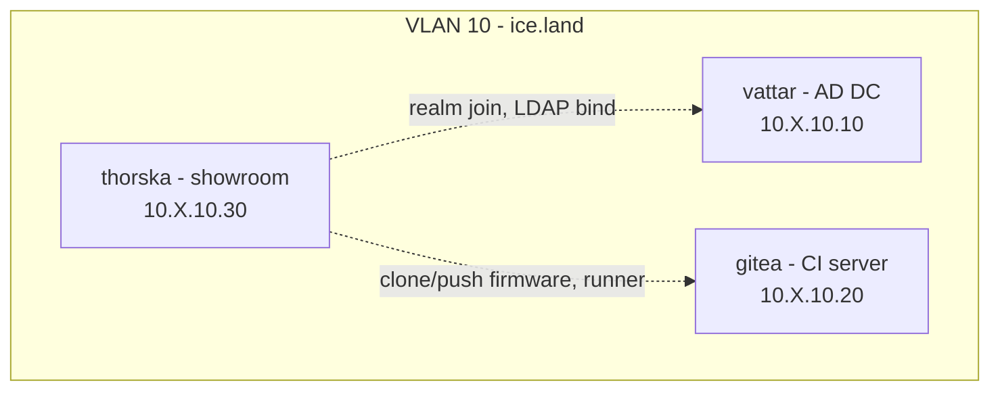

# Thorska Smart-Home Showroom

A standalone AD domain, Gitea CI server, and smart-home showroom box.
`thorska` runs Home Assistant (behind Caddy with step-ca-issued TLS),
ESPHome firmware delivered through a Gitea Actions runner, a step-ca PKI
with an LDAP-backed issuance API, and black-team SSH access trusted via an
SSH CA. `vattar` is the AD domain controller everything else joins/auths
against; `gitea` hosts the firmware repo thorska's runner pulls from.

## Quick Start

```bash
ludus source add https://github.com/wccomps/wrccdc2027-inv3-thorska

# Install the 8 custom roles this blueprint uses (not on Galaxy)
for role in domain_join shell_history step_ca blackteam_ssh podman home_assistant esphome_devices gitea; do
  ludus ansible role add -d ansible/roles/$role
done

ludus blueprint apply wrccdc2027-inv3-thorska/thorska
ludus range deploy
ludus range logs -f
```

## Network Diagram



> Replace `X` with your range's second octet (`ludus range list`).
>
> `gitea` and `thorska` use `rocky-9-x64-server-template` (build it first
> with `ludus templates build -n rocky-9-x64-server-template` if it isn't
> already built - the template lives in
> [badsectorlabs/ludus-source-bsl](https://github.com/badsectorlabs/ludus-source-bsl/tree/main/templates/rocky-9-x64-server)).
> Fedora/Alpine-based templates (e.g. from `jessefmoore/custom_ludus_templates`)
> don't work here - Ludus only ships `group_vars` (and therefore working
> Ansible connectivity for user-defined roles) for `almalinux`, `centos`,
> `debian`, `kali`, `macos`, `rhel`, `rocky`, and `ubuntu`.

## VM Details

| VM Name | Hostname | Template | IP | Role |
|---|---|---|---|---|
| `{{ range_id }}-vattar` | vattar | win2022-server-x64-template | 10.X.10.10 | primary-dc (ice.land) |
| `{{ range_id }}-gitea` | gitea | rocky-9-x64-server-template | 10.X.10.20 | Gitea + Actions runner server |
| `{{ range_id }}-thorska` | thorska | rocky-9-x64-server-template | 10.X.10.30 | Home Assistant, step-ca, SSH CA trust |

## Credentials

These are the lab's intentionally shared/static passwords (see
`ansible/roles/step_ca/defaults/main.yml` for why they stay static for this
competition scenario).

| Account | Username | Password | Scope |
|---|---|---|---|
| Domain Admin | `Administrator` | `SMBlyRequired!` | ice.land domain |
| Gitea admin | `gitadmin` | `SMBlyRequired!` | gitea VM |
| Home Assistant owner | `admin` | `SMBlyRequired!` | thorska (behind Caddy) |
| step-ca API | shared token + any ice.land account | `SMBlyRequired!` (token) | thorska :8080 |

## Attack/Inject Surface

- step-ca's management API trusts any valid ice.land domain credential over
  cleartext LDAP (`ansible/roles/step_ca/API.md`) and issues both x509 and
  SSH user/host certificates - a compromised domain account becomes a
  short-lived cert mint.
- SSH on every box trusts certs signed by the same CA (`blackteam_ssh`),
  with principal mapping driven entirely by username.
- `root`'s shell history is permanently disabled (`shell_history`).
- The Gitea Actions runner on thorska executes `ansible-playbook` locally on
  every push/5-minute poll against `/opt/showroom` - a foothold in the
  `showroom-firmware` repo is a foothold on the host.

## Post-Deploy Verification

```bash
# From a box that can reach thorska's step-ca API:
blueprints/thorska/testing/check_ca_ssh.py <thorska-ip> --username scoring@ice.land
```

See `ansible/roles/step_ca/BOX_ONBOARDING.md` for issuing certs manually and
onboarding additional hosts to trust this CA.

## Acknowledgments

Packaged as a [Ludus source](https://docs.ludus.cloud/docs/using-ludus/sources)
following the layout and conventions from
[badsectorlabs/ludus-source-bsl](https://github.com/badsectorlabs/ludus-source-bsl).
